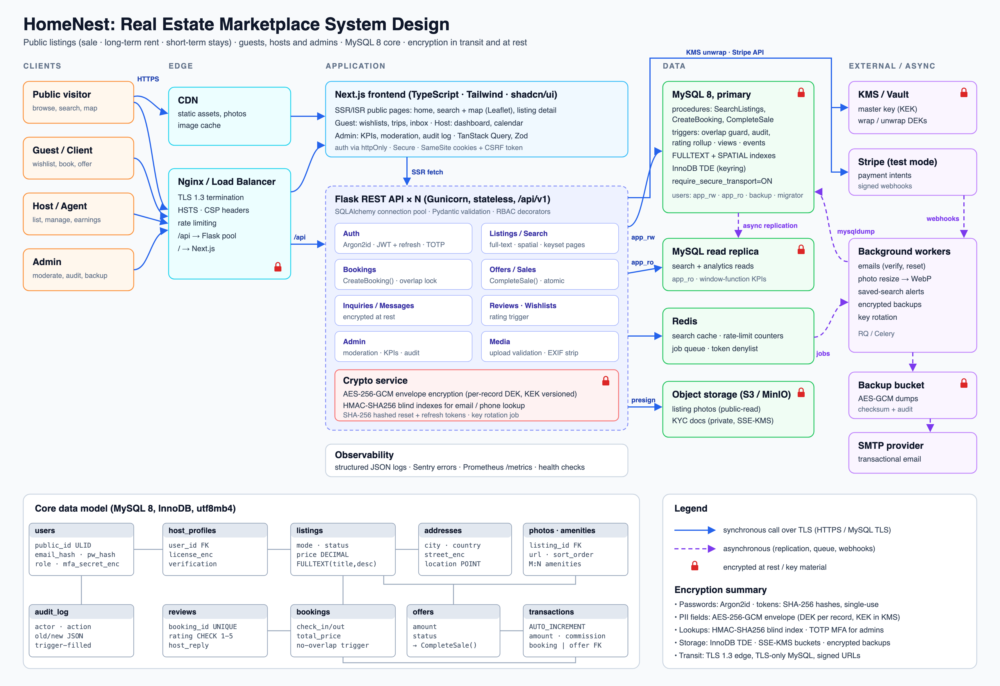
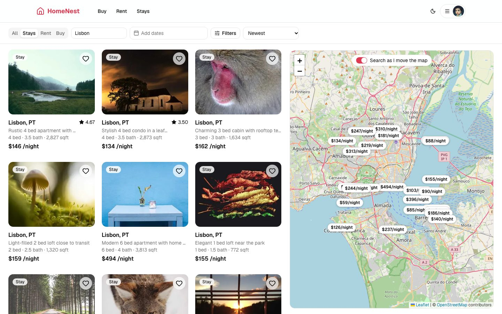
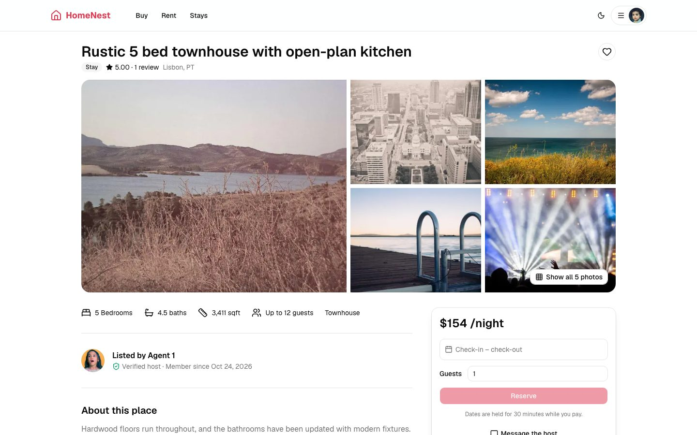
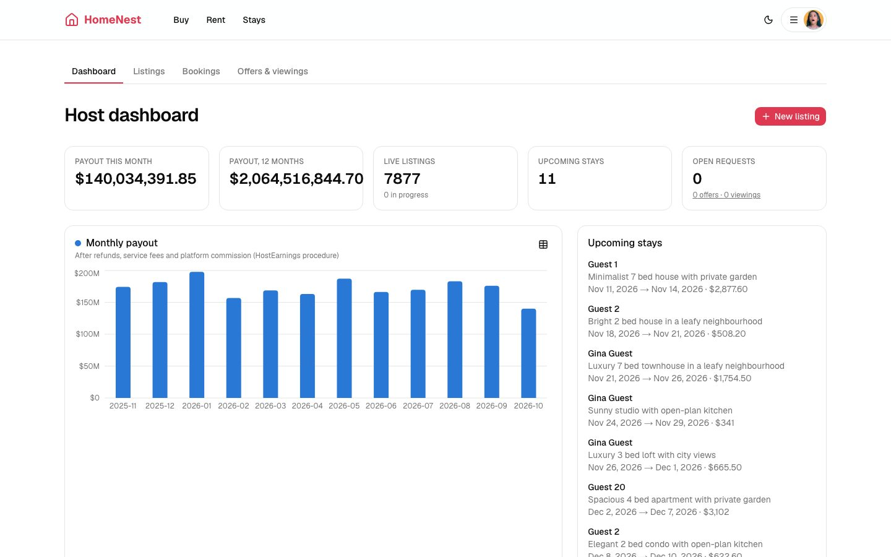
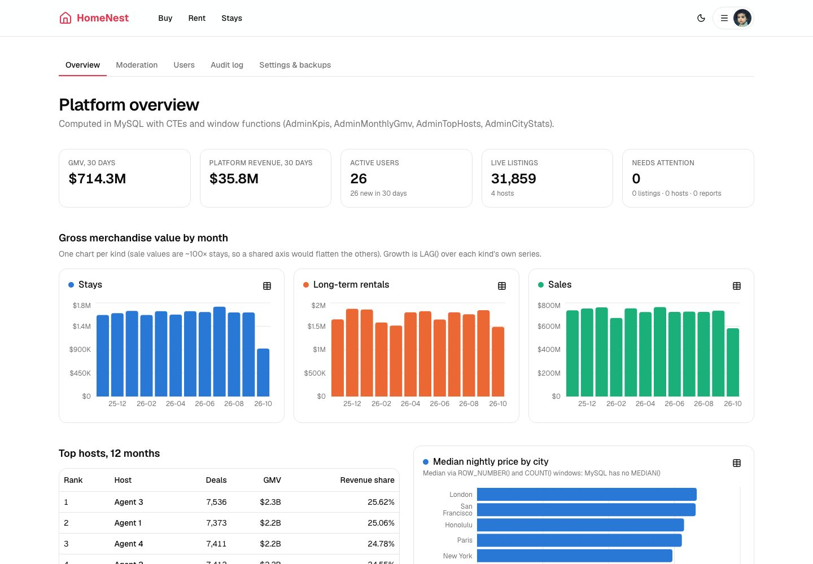

# HomeNest: real estate marketplace (MySQL, encryption, Next.js)

Buy, rent long-term, or book a stay. Anyone can browse **50,000 listings** in 34 cities on a map, with no account needed. Guests save homes, message hosts, make offers and book stays. Hosts manage listings, calendars and earnings. Admins moderate content and work from an MFA-protected console.



<p>
  
  
  
  
</p>

## Features by role

**Anyone (no account):** home page with hero search; search with filters (type, price, beds, baths, guests, amenities, full-text keywords, dates); infinite scroll; a Leaflet map with price pins and "search as I move the map"; listing pages with gallery, amenities, an approximate-area map and reviews; host profiles.

**Guests:** sign-up with email verification; login with optional TOTP; wishlist; saved searches with email alerts; encrypted messaging with hosts; viewing requests; purchase offers and rental applications; stay booking with a live quote, a 30-minute hold and payment (simulated, or Stripe Checkout when keys are set); trip page that reveals the exact address and host phone only after confirmation; cancellation with refund policy; reviews; notifications; account security (password, MFA with QR code, sessions); GDPR-style data export; account deletion.

**Hosts:** onboarding with encrypted license and phone; a listing editor with map pin, amenities and optimistic locking; photo upload (validated, EXIF-stripped, WebP); blocked dates; seasonal and weekend price rules; submit for review, pause and archive; offers and viewings inbox (accepting an offer closes the sale atomically); bookings; earnings dashboard.

**Admins** (role plus a TOTP-verified session): platform KPIs and GMV charts; top hosts; median price by city; listing moderation queue; host verification (decrypted license, view audited); user reports; review hiding; user management (roles, suspension, blind-index email search); audit log viewer; platform settings; one-click encrypted backups.

## Run it locally

Requirements: MySQL 8.0+ (tested on 9.3), Python 3.11+, Node 20+.

```bash
# 1. database accounts (as a MySQL admin); replace 'change-me' in the file first
mysql -uroot -p < db/security/grants.sql

# 2. backend
cd backend
python3 -m venv .venv && .venv/bin/pip install -r requirements-dev.txt
cp .env.example .env && .venv/bin/python scripts/gen_keys.py   # paste the output into .env
.venv/bin/alembic upgrade head
mysql -uroot -p < ../db/security/grants_after_migrate.sql
.venv/bin/python scripts/seed.py          # ~30 s: 50k listings + a year of bookings, sales, reviews
.venv/bin/gunicorn -w 4 -b 127.0.0.1:5050 wsgi:app

# 3. frontend (proxies /api to :5050)
cd ../frontend && npm ci && npm run dev    # http://localhost:3000
```

Demo accounts (password `HomeNest-demo-2026`): `guest@homenest.dev`, `host@homenest.dev`, and `admin@homenest.dev`. The admin account has MFA enabled; the seed prints its TOTP secret and `otpauth://` URI for your authenticator app. Without SMTP configured, verification and reset links are printed in the API log.

**Full stack in Docker** (Nginx with TLS, 2 API replicas, worker, scheduler, Redis, and MySQL with TDE and TLS-only connections):

```bash
cp .env.docker.example .env.docker   # fill in secrets
./docker/nginx/gen-certs.sh
docker compose --env-file .env.docker up -d --build
docker compose --env-file .env.docker --profile tools run --rm migrate
docker compose --env-file .env.docker run --rm api python3.12 scripts/seed.py
```

## Tests and quality

```bash
cd backend && TEST_DATABASE_URL=mysql+pymysql://root@127.0.0.1:3306/homenest_test .venv/bin/pytest -q
```

There are 31 tests, run against a real MySQL rebuilt from the migrations. Nothing in the database is mocked. They cover a concurrent double-booking race, atomic offer acceptance, refresh-token reuse detection, single-use reset tokens, TOTP replay protection, admin MFA gating, optimistic locking, host isolation, ciphertext at rest (email, phone, messages), KEK rotation, append-only audit, EXIF stripping, encrypted-backup round trip with tamper detection, date-aware search, review constraints and saved-search alerts. CI (`.github/workflows/ci.yml`) runs them with lint, a production build and dependency audits; `pip-audit` and `npm audit` are clean.

**Load test** (`make loadtest`, Locust, public read path): 300 concurrent users, 15,384 requests, **0 failures, p95 8 ms, p99 17 ms**, about 257 req/s. This was measured on a laptop: 8 gunicorn workers, local MySQL, in-process cache, no Redis.

## Repository layout

```
backend/            Flask API: app/api (blueprints), app/security (crypto, tokens, RBAC, MFA),
                    migrations (Alembic, runs db/*.sql), scripts (seed, rotate keys, decrypt backup),
                    tests, loadtest
db/                 hand-written SQL: schema/, procedures/, views/, events/, security/ (grants, TDE)
frontend/           Next.js app: src/app (routes), src/components, src/lib
docker/             MySQL image (keyring + TLS), Nginx edge config
docs/               PLAN.md, DATABASE.md, SECURITY.md, system design, screenshots
```